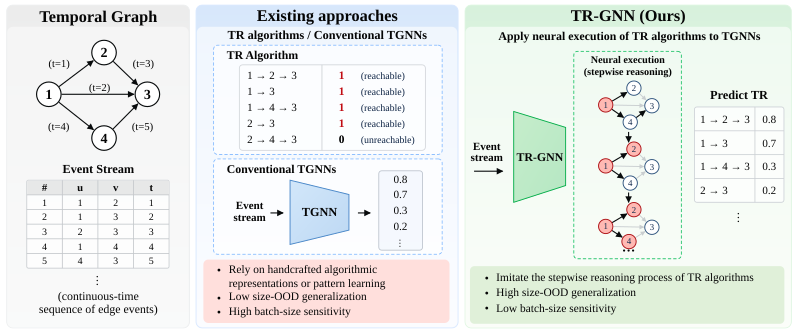
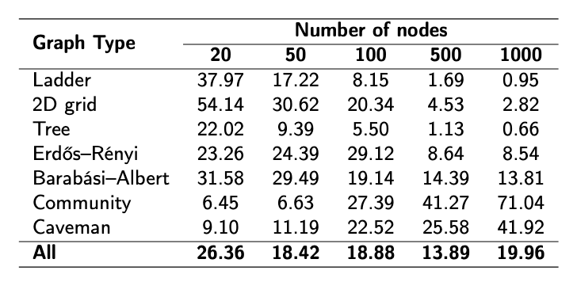
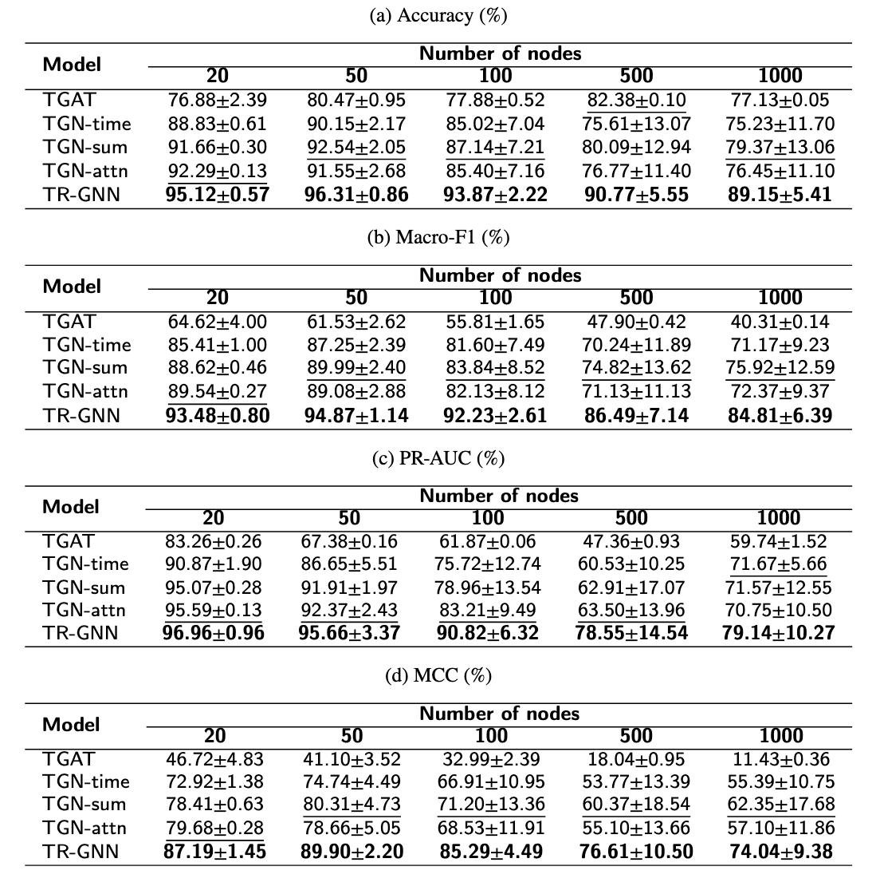

# Paper Implementation
### TR-GNN: Neural Execution for Temporal Reachability Prediction 
> - 석사학위논문
> - [Paper Link](https://sejong.dcollection.net/public_resource/pdf/200000953223_20260710202620.pdf)

### Overview 

  

 

### 평가 데이터셋 정보(Temporal Reachability Ratio)

  

 

### Evaluation (ID)
<table>
  <tr>
    <th align="center">Model</th>
    <th align="center">Sampling</th>
    <th align="center">Acc (%)</th>
    <th align="center">Positive Recall (%)</th>
    <th align="center">Negative Recall (%)</th>
    <th align="center">PPR (%)</th>
    <th align="center">Prediction Bias (%)</th>
    <th align="center">H1 Acc (%)</th>
    <th align="center">H2 Acc (%)</th>
    <th align="center">H3 Acc (%)</th>
  </tr>
  <tr>
    <td rowspan="2" align="center">TGAT</td>
    <td align="center">Random</td>
    <td align="center">75.39</td>
    <td align="center">98.78</td>
    <td align="center">52.00</td>
    <td align="center">73.39</td>
    <td align="center">+23.39</td>
    <td align="center">98.93</td>
    <td align="center">99.20</td>
    <td align="center">89.81</td>
  </tr>
  <tr>
    <td align="center">Focused</td>
    <td align="center">70.00</td>
    <td align="center">100.00</td>
    <td align="center">40.00</td>
    <td align="center">80.00</td>
    <td align="center">+30.00</td>
    <td align="center">100.00</td>
    <td align="center">100.00</td>
    <td align="center">100.00</td>
  </tr>
  <tr>
    <td rowspan="2" align="center">TGN</td>
    <td align="center">Random</td>
    <td align="center">90.81</td>
    <td align="center">88.18</td>
    <td align="center">93.44</td>
    <td align="center">47.37</td>
    <td align="center">-2.63</td>
    <td align="center">97.86</td>
    <td align="center">88.19</td>
    <td align="center">46.30</td>
  </tr>
  <tr>
    <td align="center">Focused</td>
    <td align="center">92.89</td>
    <td align="center">95.63</td>
    <td align="center">90.15</td>
    <td align="center">52.74</td>
    <td align="center">+2.74</td>
    <td align="center">99.79</td>
    <td align="center">96.05</td>
    <td align="center">69.44</td>
  </tr>
  <tr>
    <td rowspan="2" align="center">DyGFormer</td>
    <td align="center">Random</td>
    <td align="center">73.67</td>
    <td align="center">48.52</td>
    <td align="center">98.82</td>
    <td align="center">24.85</td>
    <td align="center">-25.15</td>
    <td align="center">76.66</td>
    <td align="center">44.42</td>
    <td align="center">7.41</td>
  </tr>
  <tr>
    <td align="center">Focused</td>
    <td align="center">82.09</td>
    <td align="center">74.18</td>
    <td align="center">90.00</td>
    <td align="center">42.09</td>
    <td align="center">-7.91</td>
    <td align="center">96.57</td>
    <td align="center">71.67</td>
    <td align="center">26.85</td>
  </tr>
  <tr>
    <td rowspan="2" align="center">ReaCH-TGN</td>
    <td align="center">Random</td>
    <td align="center">70.52</td>
    <td align="center">87.41</td>
    <td align="center">53.63</td>
    <td align="center">66.89</td>
    <td align="center">+16.89</td>
    <td align="center">92.93</td>
    <td align="center">86.73</td>
    <td align="center">76.85</td>
  </tr>
  <tr>
    <td align="center">Focused</td>
    <td align="center">68.31</td>
    <td align="center">36.81</td>
    <td align="center">99.81</td>
    <td align="center">18.50</td>
    <td align="center">-31.50</td>
    <td align="center">54.82</td>
    <td align="center">34.49</td>
    <td align="center">4.63</td>
  </tr>
  <tr>
    <td align="center">TR-GNN</td>
    <td align="center">Focused</td>
    <td align="center">94.83</td>
    <td align="center">98.11</td>
    <td align="center">91.55</td>
    <td align="center">53.28</td>
    <td align="center">+3.28</td>
    <td align="center">99.79</td>
    <td align="center">98.26</td>
    <td align="center">87.96</td>
  </tr>
</table>

### Evaluation (OOD)

  

